# Garmin Connect IQ - watch faces and apps

Watch faces and apps for Garmin watches, written in **Monkey C** with the **Connect IQ SDK**.
The main product is **Digital Face**, a configurable digital watch face for round AMOLED watches,
built for 41 models and running on a tactix 8.

> **This is a showcase.** The source code lives in a private repository, because the watch face is
> headed for the Connect IQ Store. Below are the screens, what the project contains, how it is built,
> and excerpts of the real code shown as images. Happy to walk through the full code in an interview.

  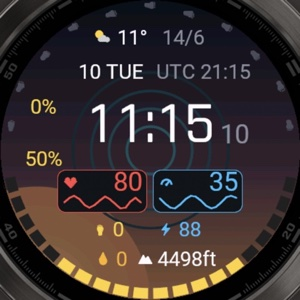
  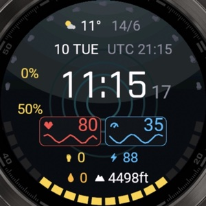
  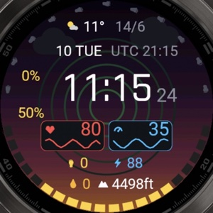
  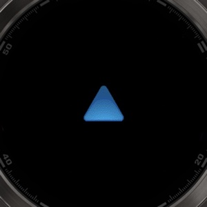

*The live background follows the time of day, the weather and the heart-rate zone. Screenshots from the Connect IQ simulator (fēnix 8 / tactix 8, 454×454).*

## What the project contains

| Project | Type | Status |
|---|---|---|
| Digital Face | Watch face | **v0.4.0**, builds for 41 round AMOLED models |
| Torch app | Watch app | Flashlight test: LED color and strobe |
| Torch toggle | Watch app + complication | Turns the LED on/off and exits; publishes a complication so a watch face can launch it |
| Probe face | Watch face | Device probe: Hebrew rendering, long press, double press, `Complications.exitTo` |
| Tools | Scripts | Build for all models, simulator screenshots, demo variants, this showcase |

## Digital Face

- **Time and date** with seconds, a **second time zone** (including half- and quarter-hour offsets such as UTC+5:30), and current weather with high/low
- **Two arcs**: steps toward the daily goal (footprints) and battery (cells that drain from both ends)
- **4 layouts** and **6 data slots**, each one set to any of 15 metrics: heart rate, stress, Body Battery, steps, calories, altitude, floors, intensity minutes, Pulse Ox, respiration, temperature, notifications, battery, sunrise/sunset, distance
- **Cards with sparklines** (last hours of heart rate, stress, Body Battery, altitude, SpO2) or a goal bar
- **8 background styles**: none, flame, sunset, running track, heart-rate rings, live, sea and summer, solid color, with 4 palettes (warm, tactical, camping, sea) and 3 intensity levels
- **5 color themes** and **8 languages**: English, Hebrew, Spanish, French, German, Italian, Portuguese, Russian, or follow the watch language
- **Settings in two places**: the Garmin Connect phone app and an on-watch menu, both writing the same properties
- **Long press** on the face opens a chosen complication, meaning any app or system feature that publishes one

### Layouts

  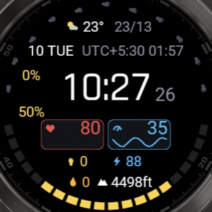
  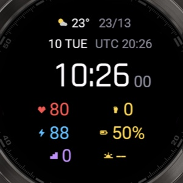
  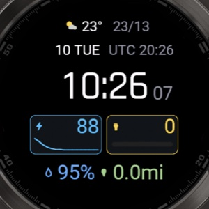
  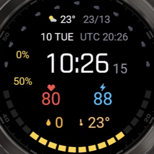

V2 (arcs + cards + rows) · A (six equal slots) · B (big cards + row) · C (arcs + two big values)

### Background styles

  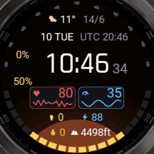
  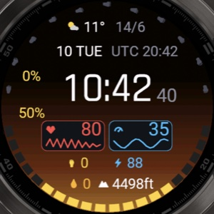
  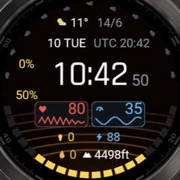
  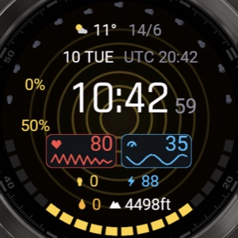
  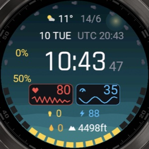
  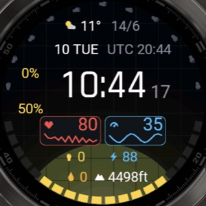

Flame · Sunset · Running track · Heart-rate rings · Sea and summer · Flame with the tactical palette

### Live background, without the data on top

  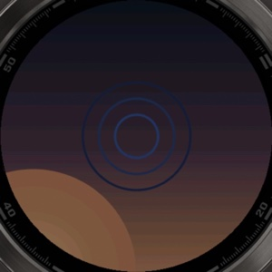
  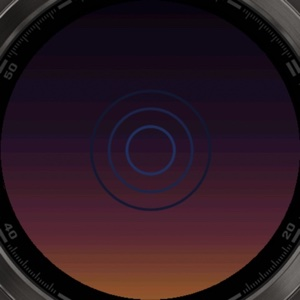
  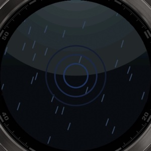
  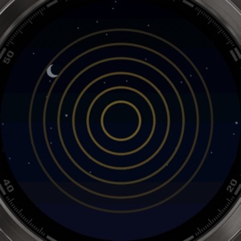
  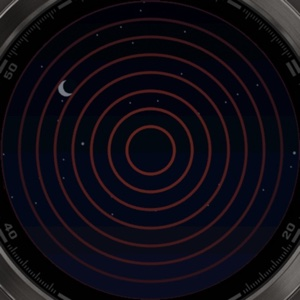

Morning · Evening · Rain · Heart-rate zone 3 · Zone 5. Each zone adds a ring and shifts the color from blue to red.

### On-watch settings

  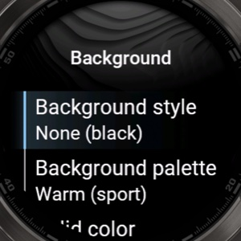
  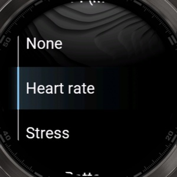

Background submenu · Choosing the metric for a slot

## How it works

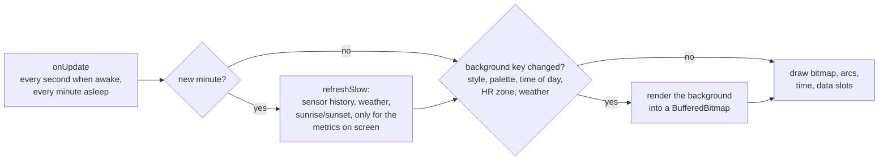

- **Memory.** A watch face gets about 124 KB. Background images would not fit, so every background is drawn in code, rendered once into a `BufferedBitmap` (graphics pool, not the app heap) and redrawn only when its inputs change. The face uses about 45 KB.
- **Battery and AMOLED.** Slow data is cached once a minute, and only the metrics that are on screen are loaded. In sleep mode the background is black.
- **No GPS permission.** Time of day comes from sunrise and sunset at the weather forecast's location. Heart-rate zones come from the user profile.
- **41 devices from one codebase.** APIs that differ between models are checked at runtime with `has`, and fonts are picked by measuring what fits each screen.
- **Hebrew (RTL).** Digits and Hebrew words are drawn as separate strings, because a mixed string can come out in the wrong order.
- **Testing.** Scripts build every model, run the simulator and capture only its window. Each demo variant gets its own app id, because the simulator keeps settings per app id, and states like a heart-rate zone or the weather can be fixed per variant to screenshot each one.

## Code samples

Excerpts from the private repository, generated from the current code.

The background is drawn once into a `BufferedBitmap` and redrawn only when its inputs change. Every other second just copies the bitmap.

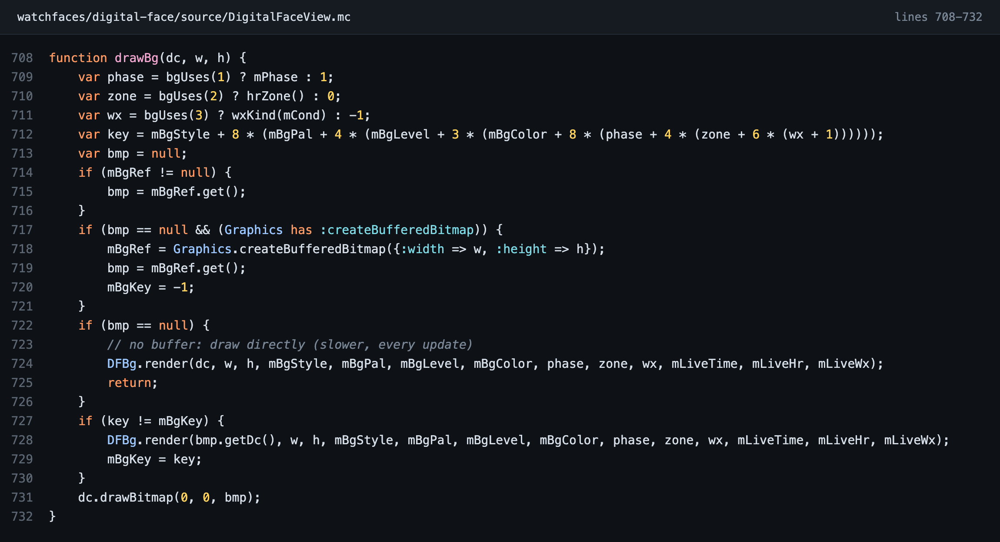

No image assets: gradients and glows are drawn in code, which keeps the face at about 45 KB of its 124 KB budget.

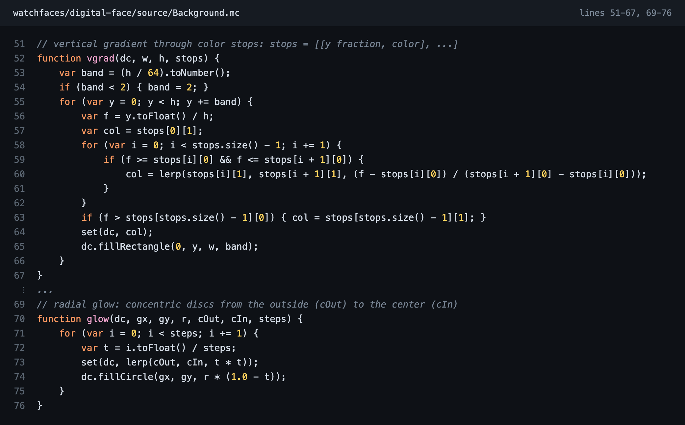

Time of day from today's sunrise and sunset at the forecast location, so the face needs no GPS permission.

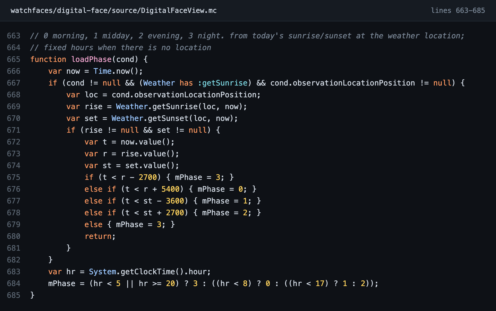

The heart-rate zone comes from the user's own zones, read once and cached.

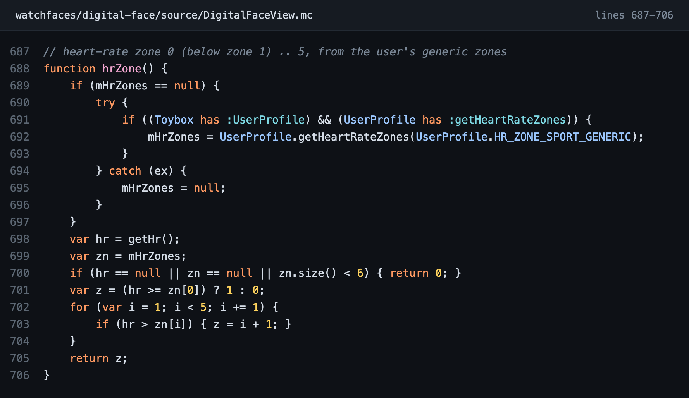

Slow data is refreshed once a minute, and only for the metrics that are on screen.

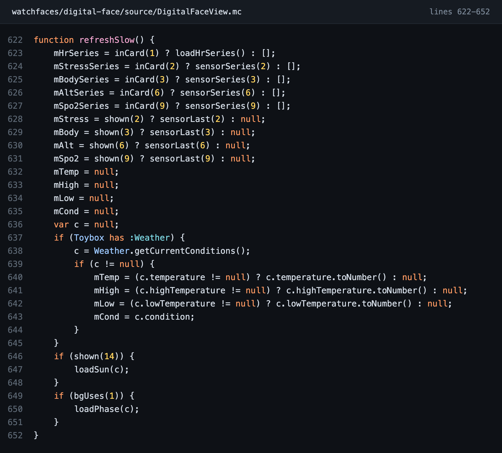

On-watch settings with `Menu2`. They write the same properties as the phone app, so both stay in sync.

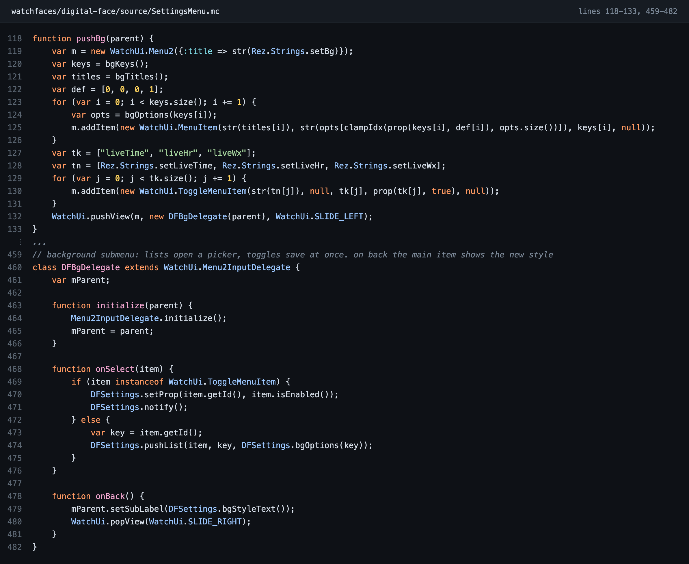

One command builds the face for all 41 supported models.

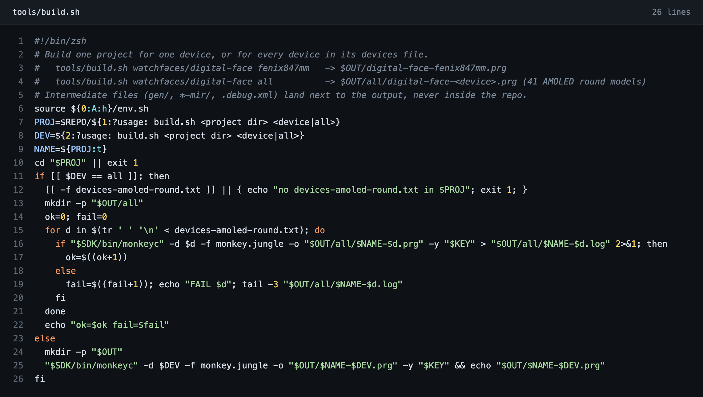

## Project structure

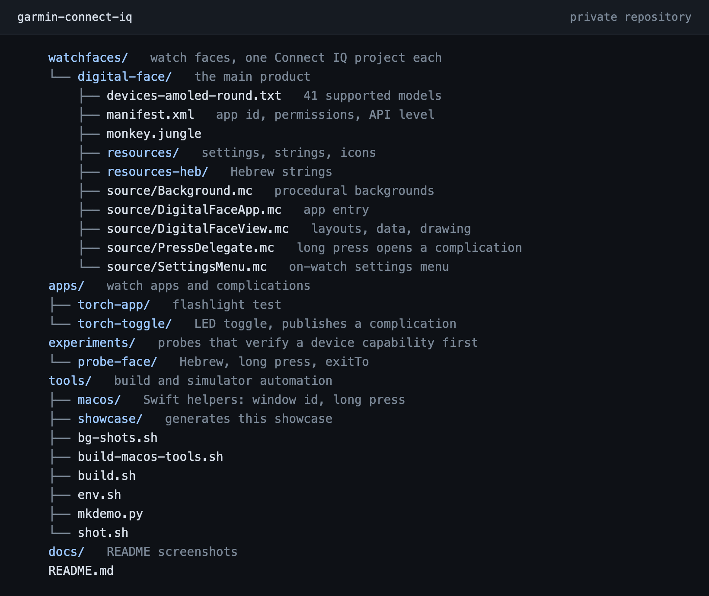

## Roadmap

- **v0.5:** flashlight from the watch face (a long press launches the torch toggle), and a tactical theme
- An analog watch face
- MIP (non-AMOLED) displays
- Publishing in the Connect IQ Store

## Author

**Roy Cuperman**, full stack developer (C# / .NET) and team lead.
[LinkedIn](https://www.linkedin.com/in/roy-cuperman) · [roylp.copermans.tech](https://roylp.copermans.tech)

Screenshots and code excerpts © Roy Cuperman. All rights reserved.
